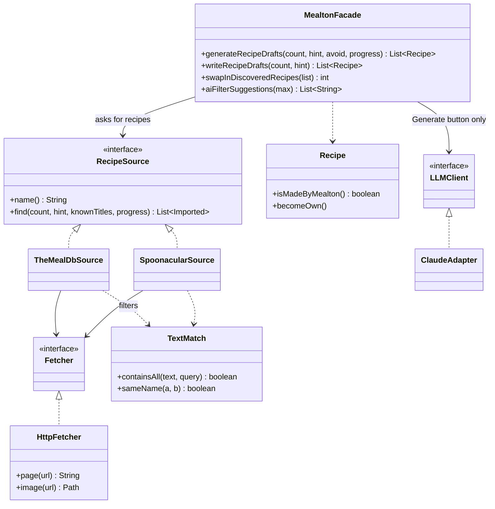
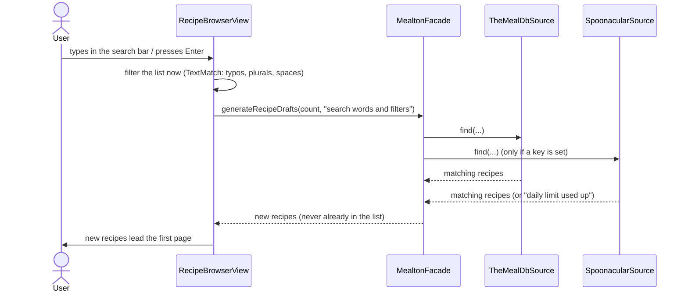

# EECS3311 Fall 2026 — Course Project, Stage 2
# Mealton: AI Smart Recipe and Meal Planning Agent

**Student:** Rebekah Uson (221123310)
**Repository:** https://github.com/Marbles85/Mealton (code in `Stage2/`, Stage 1 report in `Stage1/`)
**Stack:** Java 17, Maven, JavaFX 21.0.2 (GUI), Jackson 2.16.1 (JSON), JUnit 5.10.2 (tests), Claude API (runtime AI agent)

### Where to find each Stage 2 deliverable

| Deliverable | Where |
|---|---|
| Working application (CLI + GUI + AI chat agent) | `Stage2/src/main/java/com/mealton` |
| Setup, run and usage instructions | `Stage2/README.md` |
| API-key template (no real key) | `Stage2/.env.example` |
| Unit tests | `Stage2/src/test/java/com/mealton` |
| Feature → implementation map | Section 1 |
| Design patterns and UML | Section 2 |
| Changes from Stage 1 | Section 3 |
| AI tools log (tokens and cost) | Section 4 |
| Development process and verification (weekly commits) | Section 5 |
| Demo videos with timestamps | Section 6 |

---

# 1. Feature → Implementation Map

Every feature from the Stage 1 specification (F01–F14, plus UC00 accounts) and where it lives. "GUI" is the JavaFX page, "CLI" the command, "Chat" the agent tool the AI can call. Packages are under `com.mealton`.

| ID | Feature | Main classes | GUI | CLI | Chat tool |
|---|---|---|---|---|---|
| UC00 | Register / login, per-user saved data | `account.AccountService`, `account.PasswordHasher`, `account.Session`, `persistence.UserDataStore`, `persistence.UserDataMapper` | `LoginView`, "Remember me" (`UiSettings`) | login / sign-up prompt (`cli.AuthPrompt`), `logout`, `whoami` | n/a |
| F01 | Profile and dietary constraints (diet, allergies, calorie and macro goals, warnings on conflicting recipes) | `profile.ProfileService`, `UserProfile`, `TargetCalculator`, `Diet`, `recipe.ProfileCheck` | `ProfileView` | `profile ...` | `ProfileTool` |
| F02 | AI weekly / date-range meal plan | `plan.RangePlanner`, `PlanService`, `VarietyStrategy`, `PantryFirstStrategy`, `PlanStrategy` | `PlanMealsView` (options, cuisines, preview, drag to rearrange, keep / regenerate, apply) | `plan generate ...` | `PlanMealsTool`, `PlanTool` |
| F03 | Meal calendar editing and custom labels | `plan.CalendarService`, `PlannedMeal`, `MealEntry`, `DayPlan`, `WeekPlan` | `MealPlanView` (week view, tags, move, swap, undo) | `calendar load/week/day/set` | `CalendarTool` |
| F04 | Macro tracker / food diary | `nutrition.MacroTracker`, `DailyProgress`, `LoggedFood`, `diary.MealLogService`, `diary.PortionNotes` | `FoodDiaryView` | `food ...` | `NutritionTool` |
| F05 | Prep-day planner | `plan.PrepPlanner`, `plan.PrepScheduler` | `PrepDayView` | `plan prep` | `PrepDayTool` |
| F06 | Pantry inventory and freshness alerts | `pantry.PantryInventory`, `PantryItem`, `Freshness`, `FreshnessScheduler`, `PantryObserver`, `CategoryLayout` | `PantryShoppingView` (pantry side) | `pantry ...` | `PantryTool` |
| F07 | Recipes from the current pantry (Can make now, Almost there) | `recipe.RecipeMatcher`, `RecipeAdvisor`, `RankingStrategy`, `BestMatchStrategy`, `UseExpiringFirstStrategy` | `RecipeBrowserView` tabs | `recipe now`, `recipe almost`, `recipe suggest` | `MealIdeasTool`, `RecipeTool` |
| F08 | Missing ingredients → shopping list | `RecipeAdvisor` + `shopping.ShoppingService` | "Add missing to shopping list" button | `recipe missing <id>` | `MealIdeasTool` |
| F09 | Recipe filters and tagging | `recipe.RecipeTag`, `Recipe.getAiTags`, `util.TextMatch`, `MealtonFacade.aiFilterSuggestions` | filter chips, custom filters, search bar, card tags | `recipe tags` | `RecipeTool` |
| F10 | Serving scaling and unit conversion | `util.UnitConverter`, `Recipe.scaledTo`, `recipe.RecipeIngredient` | servings stepper on a recipe | `convert`, `scale`, `recipe scale` | `ConvertTool` |
| F11 | Nutrition breakdown | `nutrition.RecipeNutrition`, `FoodTable`, `RecipeNutritionEstimator`, `Nutrients` | nutrition panel on a recipe | `recipe nutrition` | `NutritionTool` |
| F12 | Shopping list (categories, tick, clear, undo / redo) | `shopping.ShoppingList`, `ShoppingService`, `ShoppingItem`, `ItemState` family, `command.*` | `PantryShoppingView` (list side) | `shop ...` | `ShoppingListTool` |
| F13 | Rating, My Recipes, saved recipes | `recipe.Recipe`, `RecipeBook`, `RecipeSource` family, `RecipeImporter` | heart, stars, `+ New recipe`, import from link, edit | `recipe rate/save/unsave/mine/top` | `RecipeTool`, `RecipeEditTool` |
| F14 | Mealton chat agent (tool use, memory) | `agent.MealtonAgent`, `ToolRegistry`, `Tool`, `AgentMemory`, `llm.ClaudeAdapter`, `LLMClientFactory`, `MockLLMClient` | `ChatView`, `ChatLayer` (Ask Mealton) | `chat ...` | all tools above |

All features go through one entry point, `facade.MealtonFacade`, so the GUI, the CLI and the agent behave the same way.

### Recipe sourcing (the largest Stage 2 addition)

The **All recipes** tab is filled from the internet without using AI tokens:

| Class | Role |
|---|---|
| `recipe.RecipeSource` | Interface: `find(count, hint, knownTitles, progress)` |
| `recipe.TheMealDbSource` | Free TheMealDB API (no key). Filters by title, category, area, tags and ingredients |
| `recipe.SpoonacularSource` | Spoonacular `complexSearch` (optional key in `.env`): diet, type and cuisine filters, ratings, times |
| `recipe.HttpFetcher` | Safe downloader (public hosts only, size and time limits) used by both sources and by "Import from a link" |
| `facade.MealtonFacade.generateRecipeDrafts` | Mixes the available sources, skips titles you already have, reports honestly when nothing new exists |
| `MealtonFacade.writeRecipeDrafts` | The **only** Claude path for recipes: the "Generate with Mealton" button writes one recipe (auto-saved to My Recipes, marked "Generated by Mealton") |

---

# 2. Design Patterns and UML

## 2.1 Patterns implemented

| Pattern | Where in the code | Why it is used |
|---|---|---|
| **Facade** | `facade.MealtonFacade` | One entry point for the GUI, the CLI and the agent tools |
| **MVC** | `gui.*View` (view), `MealtonFacade` (controller), domain classes (model) | Screens never touch repositories directly |
| **Strategy** | `recipe.RankingStrategy` (`BestMatchStrategy`, `UseExpiringFirstStrategy`); `plan.PlanStrategy` (`VarietyStrategy`, `PantryFirstStrategy`); **new:** `recipe.RecipeSource` (`TheMealDbSource`, `SpoonacularSource`) | Swap how recipes are ranked, planned or found |
| **Adapter** | `llm.LLMClient` ← `ClaudeAdapter` / `MockLLMClient`; **new:** the two `RecipeSource` classes adapt different web APIs to one interface | Keep vendor details out of the rest of the app |
| **Factory Method** | `llm.LLMClientFactory`, tool creation in `agent.ToolRegistry` | Choose Claude or mock from `.env`; build agent tools |
| **Observer** | `pantry.PantryObserver` (`PantryInventory` is the subject), profile-change listeners | Alerts and live macro bars update when data changes |
| **Command** | `command.Command`, `CommandHistory`; `AddShoppingItemCommand`, `DeleteItemsCommand`, `ToggleItemCommand`, `TogglePinCommand`; calendar undo | Undo / redo for shopping edits and calendar changes |
| **State** | `shopping.ItemState`, `PendingState`, `CheckedState` | A shopping item behaves differently when ticked |
| **Composite** | `plan.PlanComponent`, `WeekPlan`, `DayPlan`, `MealEntry` | Week → day → meal treated uniformly |
| **Repository** | `repository.Repository`, `RecipeRepository`, `PantryRepository`, in-memory implementations; `persistence.UserDataStore` | Storage can change without touching the logic |

## 2.2 UML

The Stage 1 diagrams are still valid for the core design and are kept in `Stage1/diagrams/` (`ClassDiagram_A_Presentation.png`, `ClassDiagram_B_Domain.png`, `ClassDiagram_C_Services_Agent.png`, `UseCaseDiagram.png`, sequence diagrams `SD01`–`SD09`). Stage 2 changed the design in the places below; the class diagram for the new recipe-sourcing part follows.

Sequence of the search bar (new in Stage 2):

---

# 3. Changes from Stage 1

| Area | Stage 1 plan | What was built | Why |
|---|---|---|---|
| Recipe finding | Browse a recipe library | Online recipe services (TheMealDB, Spoonacular) feed the All recipes tab; Claude only writes a recipe when the user presses the Generate button | An early version used Claude web search and cost about 200,000 tokens per Refresh; the services are free and give real photos and links (and ratings from Spoonacular) |
| F09 tagging | AI tags | Tags are worked out by plain code (`RecipeTag`) and from service data (area, category), plus auto tags on cards | Same recipe always gets the same tags and costs no tokens |
| Nutrition | Nutrition API adapter | Built-in `FoodTable` of typical values; Claude estimates only the gaps, marked "(estimate)" | No extra key or service needed |
| Search | Simple text filter | `TextMatch`: ignores case and spaces, handles plurals and typos ("egg" = "eggs", "glutenfree" = "gluten free"); used across recipes, pantry, shopping and the agent | Forgiving search was a usability requirement |
| Water | Treated like any ingredient | Plain water is assumed to be available and never counts as missing | Nobody shops for water |
| Saved recipes | Library recipes were read-only | A recipe you save (heart) can be edited wherever it came from, and then becomes yours | Requested during testing |
| Generated recipes | Not specified | Recipes the AI writes are marked "Generated by Mealton", auto-saved, and have their own filter on every tab | Keeps AI content visible but out of the way |
| Accounts and data | In-memory only | Login / sign-up, per-user JSON save file | Needed for a usable GUI |
| GUI | Chat plus lists | Full JavaFX app: Recipes, Log food, Meal plan, Pantry & list, Profile, Ask Mealton | Followed the interface mockup |
| Token control | Not specified | Every Claude call is printed to the console with the feature that made it and its token counts (`[Mealton] Claude call from ...`) | Made it possible to find and remove a hidden cost |

### Known limitations (honest list)

- Spoonacular's free plan has a daily limit; when it is used up the app says so and uses TheMealDB only.
- Recipes loaded from the web can come through incomplete or glitched; the app shows a notice and a "View original" link on each one.
- The profile check uses ingredient words; it is a warning, not a safety guarantee.
- Some GUI-only conveniences (for example drag-and-drop on the month view, the Prep-day "Done" ticks being kept after a restart) have no CLI equivalent or are not stored.
- The planner does not enforce a minimum daily calorie floor.

---

# 4. AI Tools Log

### 4.1 Tools used

| Tool | Model | Used for |
|---|---|---|
| Claude Code (Anthropic) | Claude Sonnet 5.5 | Writing and revising Java code and tests, refactoring, debugging from console output and screenshots, drafting this report and the README |
| Claude (Anthropic API, at runtime) | `claude-haiku-5-5` | The Mealton chat agent (tool use), writing a recipe on request, nutrition gap estimates, import tidy-up, prep-day text |
| (add any other AI tool you used, for example ChatGPT, Copilot, or a diagram tool) | | |

### 4.2 Usage log

> **Fill in from your own usage pages.** Development tokens: claude.ai usage / Claude Code session usage. Runtime tokens: Anthropic Console → Usage and Cost (filter by your API key and by date). Keep the numbers real.

| Date range | Tool | Purpose | Input tokens | Output tokens | Cost (USD) |
|---|---|---|---|---|---|
| Oct 26 – Nov 1 | Claude Code (Sonnet 5.5) | Core domain, pantry, shopping, commands, CLI, Claude adapter | ___ | ___ | ___ |
| Nov 9 – Nov 15 | Claude Code (Sonnet 5.5) | Recipes, plan, calendar, profile, diary, GUI, recipe services, search, tests | ___ | ___ | ___ |
| Oct 26 – Nov 15 | Anthropic API (`claude-haiku-5-5`) | Runtime testing of chat, recipe writing, estimates | ___ | ___ | ___ |
| | | **Total** | ___ | ___ | ___ |

### 4.3 Real figures recorded by the app

The app prints every Claude call with its token counts. Examples from testing:

| Feature | Input tokens | Output tokens | Note |
|---|---|---|---|
| Generate one recipe with Mealton | 1,675 | 1,295 | one press of the button |
| Generate one recipe with Mealton | 1,392 | 1,193 | one press of the button |
| Old web-search Refresh (removed) | about 25,000–36,000 per search topic, about 200,000 per Refresh | about 1,000–2,000 | replaced by free recipe services |

### 4.4 How AI output was checked

- Every AI-written change was compiled and run by the author in Eclipse, and covered by JUnit tests (Section 5).
- AI-written recipes go through the normal `Recipe` validation; unusable replies are skipped.
- Findings that came from screenshots and console output (for example the Spoonacular "406" error, the hidden web-search cost) were reproduced and then fixed.
- The API key lives only in the local `.env`; `.env` is gitignored and was never committed.

---

# 5. Development Process and Verification

## 5.1 Weekly commit history

Repository: https://github.com/Marbles85/Mealton — 289 commits in total (as of this report).

| Week | Commits | Range | What was built | Key commits |
|---|---|---|---|---|
| Oct 26 – Nov 1 | 61 | [`a0bcbb8` → `5e2ba5c`](https://github.com/Marbles85/Mealton/compare/a0bcbb8...5e2ba5c) | Maven project, `.gitignore` and `.env.example`, pantry, freshness and Observer, shopping State and Command patterns, facade, CLI, first GUI tabs, `AppConfig`, `ClaudeAdapter`, agent loop and tools, adapter tests | [Maven build](https://github.com/Marbles85/Mealton/commit/f94d1d9), [`.gitignore`](https://github.com/Marbles85/Mealton/commit/c7826f6), [Facade](https://github.com/Marbles85/Mealton/commit/561e75f), [ClaudeAdapter](https://github.com/Marbles85/Mealton/commit/d6fd8a4), [Agent loop](https://github.com/Marbles85/Mealton/commit/443387d) |
| Nov 2 – Nov 8 | 0 | — | No commits this week (see note below) | — |
| Nov 9 – Nov 15 | 191 | [`0d619a2` → `194023f`](https://github.com/Marbles85/Mealton/compare/0d619a2...194023f) | Recipes, matcher and ranking, profile, macro tracker, meal plan and calendar, prep-day planner, accounts and saving, the full JavaFX app, recipe services, forgiving search, editable saved recipes | [LLM factory](https://github.com/Marbles85/Mealton/commit/0d619a2), [RecipeMatcher](https://github.com/Marbles85/Mealton/commit/7ef876b), [PrepPlanner](https://github.com/Marbles85/Mealton/commit/84ccdce), [Persistence](https://github.com/Marbles85/Mealton/commit/200c9e8), [Broadening Recipes](https://github.com/Marbles85/Mealton/commit/389b7fa), [Stage 2 final](https://github.com/Marbles85/Mealton/commit/194023f) |

> **Note on Nov 2 – Nov 8:** work during this week was not committed. (Replace this line with your real reason, or with the extension rule that applies to you.)

## 5.2 Testing

- **Over 400 JUnit 5 tests** in `Stage2/src/test/java`, run with `mvn test` (or Eclipse → Run As → JUnit Test).
- Tests never call the real AI or the real recipe services: they use `MockLLMClient`, a local fake server for `ClaudeAdapter`, and fake `RecipeSource` / `Fetcher` objects.
- Examples of what is checked: undo / redo of shopping edits; pantry observers; recipe matching and ranking; profile conflicts; planner choices (`RangePlannerTest`, `CuisineMatchTest`); calendar moves and swaps; the two recipe sources (`TheMealDbSourceTest`, `SpoonacularSourceTest`, `MixedSourcesTest`); forgiving search (`TextMatchTest`); "water is never missing" (`WaterAssumedTest`); saved recipes can be edited (`EditSavedRecipeTest`); Claude is never used by search or Refresh (`WebDiscoveryTest`).

## 5.3 Manual verification

| Check | How |
|---|---|
| Search tolerance | Typed "egg" / "eggs" / "gluten free" / "glutenfree" and compared the results |
| Recipe services | Ran Refresh and searches; the console shows `[Mealton] TheMealDB returned N recipes for "..."` and `Spoonacular returned ...` |
| AI cost | Console shows every Claude call (`[Mealton] Claude call from ...` and `Claude replied: N input / N output tokens`); after the fix, only the Generate button appears |
| Secrets | `git ls-files` shows only `.env.example`; `.env` is untracked and gitignored |

---

# 6. Demo Videos

Two recordings: a **GUI demo** and a **CLI demo**. No API key, `.env` file or console line containing a key is shown at any point.

### 6.1 GUI demo — _link: ______________________

| Time | What is shown | Feature |
|---|---|---|
| ___ | Log in / create account | UC00 |
| ___ | Profile: diet, allergy, calorie and macro goals | F01 |
| ___ | Pantry: add food, expiry colours; shopping list with undo / redo | F06, F12 |
| ___ | Recipes: Can make now, Almost there, add missing to shopping list | F07, F08 |
| ___ | All recipes: search with a typo, filters, Refresh, 30 per page | F09 |
| ___ | Generate one with Mealton, saved and marked "Generated by Mealton" | F13 |
| ___ | Edit a saved recipe; scale servings; nutrition panel | F10, F11, F13 |
| ___ | Plan meals: pick days, meals and cuisines, preview, apply | F02 |
| ___ | Meal plan: drag to swap, tags, undo | F03 |
| ___ | Prep day | F05 |
| ___ | Log food and macro bars | F04 |
| ___ | Ask Mealton: a request that uses tools | F14 |

### 6.2 CLI demo — _link: ______________________

| Time | Command(s) | Feature |
|---|---|---|
| ___ | start, login | UC00 |
| ___ | `profile diet vegetarian`, `profile allergy add peanut`, `profile calories 2000` | F01 |
| ___ | `pantry add ...`, `pantry expiring`, `shop add ...`, `shop undo`, `shop redo` | F06, F12 |
| ___ | `recipe now`, `recipe almost`, `recipe missing <id>` | F07, F08 |
| ___ | `recipe scale <id> 4`, `convert 2 cup ml`, `recipe nutrition <id>` | F10, F11 |
| ___ | `recipe rate`, `recipe save`, `recipe mine`, `recipe tags` | F13, F09 |
| ___ | `food log ...`, `food today` | F04 |
| ___ | `plan generate ...`, `calendar week`, `calendar set ...`, `plan prep` | F02, F03, F05 |
| ___ | `chat what is in my pantry that will expire soon?` | F14 |
