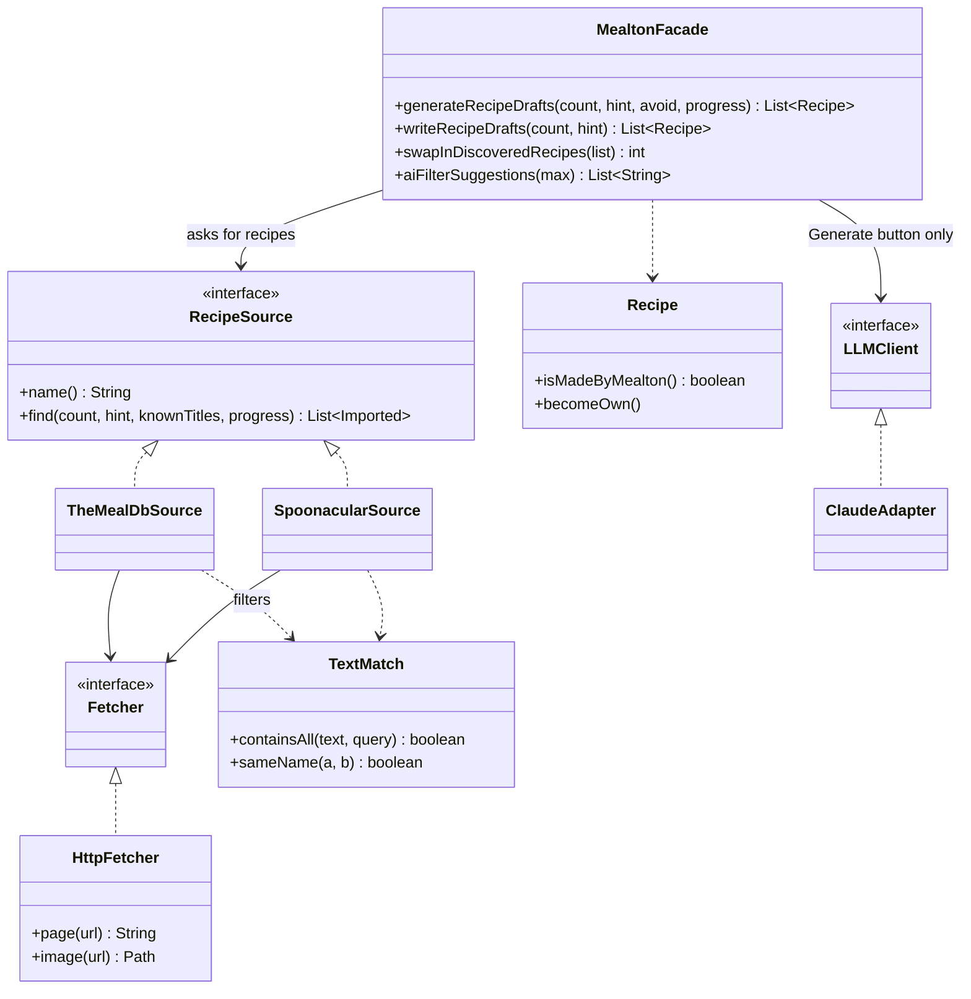
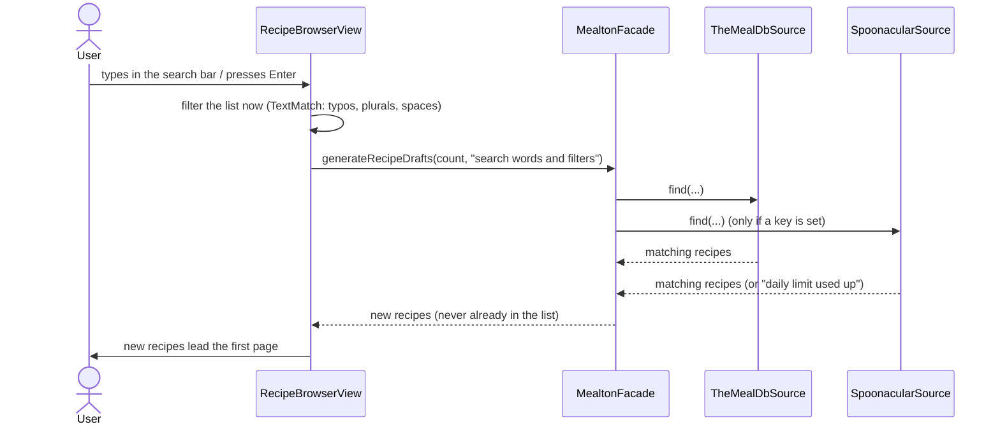

# EECS3311 Fall 2026 — Course Project, Stage 2
# Stage 2 Implementation Report — Mealton: AI Smart Recipe and Meal Planning Agent

**Student:** Rebekah Uson (221123310)  
**Repository:** https://github.com/Marbles85/Mealton (code in `Stage2/`, Stage 1 report in `Stage1/`)  
**Stack:** Java 17, Maven, JavaFX 21.0.2 (GUI), Jackson 2.16.1, JUnit 5.10.2, Claude API (runtime agent)  
**Demo videos:** GUI https://youtu.be/rCZ-0A1Pc_M · CLI https://youtu.be/7llMMoYiqjQ

# 1. Project Overview and Implementation Status

Mealton helps a person who cooks at home decide what to eat, shop and prepare. A user signs up, sets a diet, allergies and calorie/macro goals, keeps a pantry with expiry dates, and gets recipes ranked against what they own. They can plan meals for any date range, edit the calendar, prepare a prep day, log what they eat against their goals, and keep a shopping list with undo/redo. The same functions are available three ways: a **JavaFX GUI**, a **command-line interface (CLI)** and an **AI chat agent**. All three go through one class, `facade.MealtonFacade`.

**AI/LLM integration.** Claude (`claude-haiku-5-5`, through `llm.ClaudeAdapter`) powers the chat agent. The agent reasons over several steps: it receives the user's message and a list of tools, asks for tools (pantry, recipes, plan, calendar, nutrition, shopping, profile, convert, prep day), the app runs them against the real data, and the results go back to Claude until it can answer. `AgentMemory` keeps the conversation and stated preferences. Claude is also used for the "Generate with Mealton" recipe button, nutrition estimates for unknown foods, import-from-link tidy-up and prep-day text. Searching, filtering and Refresh never call Claude.

**Status.** All 14 Stage 1 features (F01–F14) and the accounts use case (UC00) are implemented and work in both the GUI and the CLI, except where noted below. Some conveniences are GUI-only (for example month-view drag and drop). The app has over 400 JUnit tests.

**Limitations (honest list).**
- Spoonacular's free plan has a daily limit; when it is used up the app says so and uses TheMealDB only.
- Recipes loaded from the web can be incomplete or glitched; each has a "View original" link.
- The profile check uses ingredient words; it is a warning, not a safety guarantee, and does not judge gluten-free or keto.
- Food values come from a built-in table of typical foods; other foods are AI estimates marked "(estimate)".
- When two planned recipes share an ingredient, the shopping list uses the larger amount, not the sum.
- Prep-day "Done" ticks are kept only while the app is open.
- The planner does not enforce a minimum daily calorie floor.
- The full deterministic test suite and agent validation are Stage 3 work.

# 2. Feature to Implementation Mapping

Every Stage 1 feature and the new accounts feature is listed. "Stage 1 reference" gives the original ID. Each entry ends with how the classes work together from user input to result, and says whether the feature is deterministic, AI-based or hybrid. Packages are under `com.mealton`. Video links jump to the timestamp.

### UC00 — Accounts: register / log in, per-user saved data

| Field | Entry |
|---|---|
| Feature ID and name | UC00 — Accounts: register / log in, per-user saved data |
| Stage 1 feature / reference | New (Stage 1 use case UC00) |
| Status or change | Implemented |
| Implemented classes / files and responsibilities | `account.AccountService` (hashing via `PasswordHasher`, sessions), `persistence.UserDataStore` / `UserDataMapper` (JSON file per user), `gui.LoginView`, `cli.AuthPrompt` |
| Key methods | `signUp`, `logIn`, `createRememberToken`, `logInWithToken` |
| Design patterns | Repository, Facade |
| Video link / timestamp | [GUI 0:00](https://youtu.be/rCZ-0A1Pc_M?t=0) · [CLI 0:00](https://youtu.be/7llMMoYiqjQ?t=0) |

**How it works and type.** Deterministic. The login screen or CLI prompt calls `AccountService`, which checks the password hash and returns the user folder; `UserDataStore` then loads that user's pantry, recipes, plan and profile into the facade's repositories.

### F01 — Profile and dietary constraints

| Field | Entry |
|---|---|
| Feature ID and name | F01 — Profile and dietary constraints |
| Stage 1 feature / reference | F01 |
| Status or change | Implemented |
| Implemented classes / files and responsibilities | `profile.ProfileService`, `UserProfile`, `TargetCalculator` (suggested goals), `Diet`, `recipe.ProfileCheck` (warnings), `gui.ProfileView`, `agent.tools.ProfileTool` |
| Key methods | `setDiet`, `addAllergy`, `setCalorieGoal`, `setMacroGoals`, `suggestedTargets`, `saveProfile`, `addProfileListener` |
| Design patterns | Observer, Facade |
| Video link / timestamp | [GUI 0:00](https://youtu.be/rCZ-0A1Pc_M?t=0) · [CLI 0:37](https://youtu.be/7llMMoYiqjQ?t=37) |

**How it works and type.** Deterministic. `ProfileView` or `profile ...` calls the facade, which updates `ProfileService`; listeners notify the macro bars and recipe warnings. `ProfileCheck` compares recipe ingredient words with diet and allergies.

### F02 — AI weekly / date-range meal plan

| Field | Entry |
|---|---|
| Feature ID and name | F02 — AI weekly / date-range meal plan |
| Stage 1 feature / reference | F02 |
| Status or change | Modified (date ranges, cuisines, preview, rearrange) |
| Implemented classes / files and responsibilities | `plan.RangePlanner` (draft, pick, regenerate), `PlanService`, `PlanStrategy` with `VarietyStrategy` / `PantryFirstStrategy`, `gui.PlanMealsView`, `agent.tools.PlanMealsTool` |
| Key methods | `draftPlan`, `rerollDraftMeal`, `regenerateDraft`, `moveDraftMeal`, `swapDraftMeals`, `applyDraft`, `generatePlan` |
| Design patterns | Strategy, Composite, Facade |
| Video link / timestamp | [GUI 5:58](https://youtu.be/rCZ-0A1Pc_M?t=358) · [CLI 3:47](https://youtu.be/7llMMoYiqjQ?t=227) |

**How it works and type.** Hybrid. `PlanMealsView` collects dates, meals and cuisines and calls `draftPlan`; `RangePlanner` picks recipes with the chosen strategy (deterministic, from the recipe repository). The AI chat can start the same plan through `PlanMealsTool`; the user keeps or regenerates meals, then `applyDraft` writes them to the calendar.

### F03 — Meal calendar editing and custom labels

| Field | Entry |
|---|---|
| Feature ID and name | F03 — Meal calendar editing and custom labels |
| Stage 1 feature / reference | F03 |
| Status or change | Implemented |
| Implemented classes / files and responsibilities | `plan.CalendarService`, `PlannedMeal`, `MealEntry`, `DayPlan`, `WeekPlan`, `PlanComponent`, `gui.MealPlanView`, `agent.tools.CalendarTool` |
| Key methods | `addPlannedMeal`, `movePlannedMeal`, `swapPlannedMeals`, `setPlannedMealTag`, `removePlannedMeal`, `undoCalendar`, `redoCalendar` |
| Design patterns | Composite, Command (undo), Facade |
| Video link / timestamp | [GUI 5:58](https://youtu.be/rCZ-0A1Pc_M?t=358) · [CLI 3:47](https://youtu.be/7llMMoYiqjQ?t=227) |

**How it works and type.** Deterministic. Drag, tag and delete actions in `MealPlanView` call the facade; `CalendarService` records each change as an undoable step and updates the week/day/meal tree.

### F04 — Macro tracker / food diary

| Field | Entry |
|---|---|
| Feature ID and name | F04 — Macro tracker / food diary |
| Stage 1 feature / reference | F04 |
| Status or change | Implemented |
| Implemented classes / files and responsibilities | `nutrition.MacroTracker`, `DailyProgress`, `LoggedFood`, `diary.MealLogService`, `PortionNotes`, `gui.FoodDiaryView`, `agent.tools.NutritionTool` |
| Key methods | `logFood`, `logCustomFood`, `logRecipeMeal`, `getProgress`, `undoMealLog` |
| Design patterns | Observer, Facade |
| Video link / timestamp | [GUI 8:42](https://youtu.be/rCZ-0A1Pc_M?t=522) · [CLI 3:31](https://youtu.be/7llMMoYiqjQ?t=211) |

**How it works and type.** Hybrid. Logged food is looked up in `FoodTable` (deterministic); the AI estimates only unknown foods when asked. `MacroTracker` sums the day and the bars compare it with the profile goals.

### F05 — Prep-day planner

| Field | Entry |
|---|---|
| Feature ID and name | F05 — Prep-day planner |
| Stage 1 feature / reference | F05 |
| Status or change | Implemented |
| Implemented classes / files and responsibilities | `plan.PrepPlanner`, `PrepScheduler` (pantry-aware shopping, time limit), `gui.PrepDayView`, `agent.tools.PrepDayTool` |
| Key methods | `buildPrepSchedule`, `savePrepDay`, `addPrepShortToShoppingList`, `prepSchedule` |
| Design patterns | Facade |
| Video link / timestamp | [GUI 7:28](https://youtu.be/rCZ-0A1Pc_M?t=448) · [CLI 3:47](https://youtu.be/7llMMoYiqjQ?t=227) |

**How it works and type.** Hybrid. `PrepScheduler` groups the planned recipes and works out what is missing from the pantry using `TextMatch` and `UnitConverter` (deterministic); the AI only writes the explanatory prep text.

### F06 — Pantry inventory and freshness alerts

| Field | Entry |
|---|---|
| Feature ID and name | F06 — Pantry inventory and freshness alerts |
| Stage 1 feature / reference | F06 |
| Status or change | Implemented |
| Implemented classes / files and responsibilities | `pantry.PantryInventory` (subject), `PantryItem`, `Freshness`, `FreshnessScheduler`, `PantryObserver`, `CategoryLayout`, `gui.PantryShoppingView`, `agent.tools.PantryTool` |
| Key methods | `addPantryItem`, `updatePantryItem`, `removePantryItems`, `getExpiringItems`, `checkFreshness`, `undoPantry` |
| Design patterns | Observer, Repository |
| Video link / timestamp | [GUI 0:54](https://youtu.be/rCZ-0A1Pc_M?t=54) · [CLI 1:22](https://youtu.be/7llMMoYiqjQ?t=82) |

**How it works and type.** Deterministic. Adding or editing an item goes through the facade to `PantryInventory`, which merges duplicates, stores it in the repository and notifies observers; `FreshnessScheduler` re-checks expiry daily and the view colours items.

### F07 — Recipes from the current pantry

| Field | Entry |
|---|---|
| Feature ID and name | F07 — Recipes from the current pantry |
| Stage 1 feature / reference | F07 |
| Status or change | Implemented |
| Implemented classes / files and responsibilities | `recipe.RecipeMatcher`, `RecipeAdvisor`, `RankingStrategy` with `BestMatchStrategy` / `UseExpiringFirstStrategy`, `gui.RecipeBrowserView`, `agent.tools.MealIdeasTool` |
| Key methods | `canMakeNow`, `almostThere`, `suggestRecipes`, `checkRecipe` |
| Design patterns | Strategy, Facade |
| Video link / timestamp | [GUI 2:05](https://youtu.be/rCZ-0A1Pc_M?t=125) · [CLI 2:17](https://youtu.be/7llMMoYiqjQ?t=137) |

**How it works and type.** Deterministic. The view asks the facade; `RecipeMatcher` compares recipe ingredients with the pantry (unit-aware), `RankingStrategy` orders the results.

### F08 — Missing ingredients to shopping list

| Field | Entry |
|---|---|
| Feature ID and name | F08 — Missing ingredients to shopping list |
| Stage 1 feature / reference | F08 |
| Status or change | Implemented |
| Implemented classes / files and responsibilities | `RecipeAdvisor`, `shopping.ShoppingService`, "Add missing" button in `RecipeBrowserView`, `MealIdeasTool` |
| Key methods | `addMissingToShoppingList`, `addPlanToShoppingList`, `addCalendarWeekToShoppingList` |
| Design patterns | Command, Facade |
| Video link / timestamp | [GUI 2:05](https://youtu.be/rCZ-0A1Pc_M?t=125) · [CLI 2:17](https://youtu.be/7llMMoYiqjQ?t=137) |

**How it works and type.** Deterministic. Missing ingredients are computed against the pantry, then added through `ShoppingService` so the action can be undone.

### F09 — Recipe filters and tagging

| Field | Entry |
|---|---|
| Feature ID and name | F09 — Recipe filters and tagging |
| Stage 1 feature / reference | F09 (AI tags) |
| Status or change | Modified (tags computed by code, not AI) |
| Implemented classes / files and responsibilities | `recipe.RecipeTag`, `util.TextMatch` (forgiving search), filter chips in `RecipeBrowserView`, `RecipeTool` |
| Key methods | `tagsOf`, `canMakeNow(priority, tags)`, `aiFilterSuggestions` |
| Design patterns | Strategy, Facade |
| Video link / timestamp | [GUI 2:05](https://youtu.be/rCZ-0A1Pc_M?t=125) · [CLI 3:13](https://youtu.be/7llMMoYiqjQ?t=193) |

**How it works and type.** Deterministic (AI only suggests extra filter names). Tags come from recipe data and plain rules, so the same recipe always gets the same tags.

### F10 — Serving scaling and unit conversion

| Field | Entry |
|---|---|
| Feature ID and name | F10 — Serving scaling and unit conversion |
| Stage 1 feature / reference | F10 |
| Status or change | Implemented |
| Implemented classes / files and responsibilities | `util.UnitConverter`, `Recipe.scaledTo`, `RecipeIngredient`, `agent.tools.ConvertTool` |
| Key methods | `convertUnits`, `scaleAmount`, `scaledRecipe` |
| Design patterns | Facade |
| Video link / timestamp | [GUI 2:05](https://youtu.be/rCZ-0A1Pc_M?t=125) · [CLI 2:49](https://youtu.be/7llMMoYiqjQ?t=169) |

**How it works and type.** Deterministic. The servings stepper or `convert` / `scale` command calls the facade, which calls `UnitConverter`; the scaled copy is displayed without changing the stored recipe.

### F11 — Nutrition breakdown

| Field | Entry |
|---|---|
| Feature ID and name | F11 — Nutrition breakdown |
| Stage 1 feature / reference | F11 (nutrition API adapter) |
| Status or change | Modified (built-in table instead of an API) |
| Implemented classes / files and responsibilities | `nutrition.RecipeNutrition`, `FoodTable` (about 370 foods), `RecipeNutritionEstimator`, `Nutrients`, nutrition panel in the recipe page |
| Key methods | `recipeNutrition`, `estimateNutrition`, `pantryMacros` |
| Design patterns | Adapter (to the AI estimator), Facade |
| Video link / timestamp | [GUI 2:05](https://youtu.be/rCZ-0A1Pc_M?t=125) · [CLI 2:49](https://youtu.be/7llMMoYiqjQ?t=169) |

**How it works and type.** Hybrid. `FoodTable` handles known foods; for gaps the user presses an estimate button and Claude returns values, which are marked "(estimate)".

### F12 — Shopping list (categories, tick, clear, undo/redo)

| Field | Entry |
|---|---|
| Feature ID and name | F12 — Shopping list (categories, tick, clear, undo/redo) |
| Stage 1 feature / reference | F12 |
| Status or change | Implemented |
| Implemented classes / files and responsibilities | `shopping.ShoppingList`, `ShoppingService`, `ShoppingItem`, `ItemState` / `PendingState` / `CheckedState`, `command.*`, `gui.PantryShoppingView`, `ShoppingListTool` |
| Key methods | `addShoppingItem`, `toggleShoppingItem`, `deleteShoppingItems`, `clearChecked`, `undo`, `redo` |
| Design patterns | Command, State, Facade |
| Video link / timestamp | [GUI 1:35](https://youtu.be/rCZ-0A1Pc_M?t=95) · [CLI 1:22](https://youtu.be/7llMMoYiqjQ?t=82) |

**How it works and type.** Deterministic. Each edit becomes a `Command` run by `CommandHistory`; ticking switches the item's `ItemState`; clearing ticked items moves them to the pantry.

### F13 — Rating, My Recipes, saved recipes

| Field | Entry |
|---|---|
| Feature ID and name | F13 — Rating, My Recipes, saved recipes |
| Stage 1 feature / reference | F13 |
| Status or change | Modified (saved recipes are editable; import from link; generate button) |
| Implemented classes / files and responsibilities | `recipe.Recipe`, `RecipeBook`, `RecipeSource` family (`TheMealDbSource`, `SpoonacularSource`), `HttpFetcher`, `RecipeImporter`, `RecipeEditTool` |
| Key methods | `rateRecipe`, `saveToMyRecipes`, `updateRecipe`, `importRecipeFromLink`, `generateRecipeDrafts`, `writeRecipeDrafts` |
| Design patterns | Strategy, Adapter, Repository |
| Video link / timestamp | [GUI 2:05](https://youtu.be/rCZ-0A1Pc_M?t=125) · [CLI 3:13](https://youtu.be/7llMMoYiqjQ?t=193) |

**How it works and type.** Hybrid. Searching and Refresh use the free recipe services (deterministic, no tokens); the Generate button asks Claude to write one recipe, which is saved to My Recipes marked "Generated by Mealton".

### F14 — Mealton chat agent (tool use, memory)

| Field | Entry |
|---|---|
| Feature ID and name | F14 — Mealton chat agent (tool use, memory) |
| Stage 1 feature / reference | F14 |
| Status or change | Implemented |
| Implemented classes / files and responsibilities | `agent.MealtonAgent`, `ToolRegistry`, `Tool`, `AgentMemory`, `llm.LLMClient`, `ClaudeAdapter`, `MockLLMClient`, `LLMClientFactory`, 14 tools in `agent/tools`, `gui.ChatView` / `ChatLayer` |
| Key methods | `chat`, `MealtonAgent.run`, `ToolRegistry`, `LLMClientFactory.create` |
| Design patterns | Adapter, Factory, Facade |
| Video link / timestamp | [GUI 9:39](https://youtu.be/rCZ-0A1Pc_M?t=579) · [CLI 4:14](https://youtu.be/7llMMoYiqjQ?t=254) |

**How it works and type.** AI-based. The message is sent to Claude with the tool list; Claude may request tools, `MealtonAgent.run` executes them through the facade and feeds results back (several steps), keeping history in `AgentMemory`. Replies end with `[tools used: ...]`.

### Recipe sourcing (the largest Stage 2 addition)

The **All recipes** tab is filled from the internet without using AI tokens.

| Class | Role |
|---|---|
| `recipe.RecipeSource` | Interface: `find(count, hint, knownTitles, progress)` |
| `recipe.TheMealDbSource` | Free TheMealDB API (no key): filters by title, category, area, tags, ingredients |
| `recipe.SpoonacularSource` | Spoonacular `complexSearch` (optional key in `.env`) |
| `recipe.HttpFetcher` | Safe downloader (public hosts only, size and time limits) |
| `MealtonFacade.generateRecipeDrafts` | Mixes the available sources and skips titles you already have |
| `MealtonFacade.writeRecipeDrafts` | The only Claude path for recipes (the Generate button) |

# 3. Implemented Design Patterns

Ten distinct patterns are implemented. Each is evident in the code and solves a specific problem.

| Pattern | Design problem | Participants and roles | Source files / methods | Matches Stage 1? |
|---|---|---|---|---|
| **Facade** | GUI, CLI and agent must behave the same way without knowing the internals | `MealtonFacade` (facade); services and repositories (subsystem) | `facade/MealtonFacade.java` (all public methods) | Yes |
| **Strategy** | Ranking, planning and recipe finding need interchangeable algorithms | `RankingStrategy` ← `BestMatchStrategy`, `UseExpiringFirstStrategy`; `PlanStrategy` ← `VarietyStrategy`, `PantryFirstStrategy`; `RecipeSource` ← `TheMealDbSource`, `SpoonacularSource` | `recipe/RankingStrategy`, `plan/PlanStrategy`, `RangePlanner`, `generateRecipeDrafts` | Yes; `RecipeSource` is new |
| **Adapter** | The app must not depend on one AI or web vendor | `LLMClient` (target) ← `ClaudeAdapter`, `MockLLMClient`; `RecipeSource` adapts two web APIs | `llm/ClaudeAdapter.java` | Yes; recipe adapters are new |
| **Factory Method** | Choose Claude or mock from `.env` and build tools | `LLMClientFactory`, `ToolRegistry` | `LLMClientFactory.create` | Yes |
| **Observer** | Alerts and macro bars must update when data changes | `PantryInventory` (subject), `PantryObserver`; profile listeners | `PantryInventory.attach`, `addProfileListener` | Yes |
| **Command** | Undo/redo for shopping and calendar edits | `Command`, `CommandHistory` (invoker), `AddShoppingItemCommand`, `DeleteItemsCommand`, `ToggleItemCommand`, `TogglePinCommand`, `ShoppingList` (receiver) | `command/*`, `ShoppingService`, `undo`, `redo` | Yes |
| **State** | A shopping item behaves differently ticked vs pending | `ItemState`, `PendingState`, `CheckedState`, `ShoppingItem` (context) | `shopping/ItemState.java` | Yes |
| **Composite** | Treat week, day and meal uniformly | `PlanComponent`, `WeekPlan`, `DayPlan`, `MealEntry` | `plan/*` | Yes |
| **Repository** | Change storage without changing logic | `Repository`, `RecipeRepository`, `PantryRepository`, `UserDataStore` | `repository/*`, `persistence/*` | Yes; per-user JSON is new |
| **MVC** | Screens must not touch storage | `gui.*View` (view), `MealtonFacade` (controller), domain classes (model) | `gui/*` | Yes |

## 3.1 UML

The Stage 1 diagrams are still valid for the core design and are kept in `Stage1/diagrams/` (`ClassDiagram_A_Presentation.png`, `ClassDiagram_B_Domain.png`, `ClassDiagram_C_Services_Agent.png`, `UseCaseDiagram.png`, sequence diagrams `SD01`–`SD09`). Stage 2 changed the design in the places below; the class diagram for the new recipe-sourcing part follows.

Sequence of the search bar (new in Stage 2):

---

# 4. Changes and Rationale

Format: Original design → Implemented change → Reason → Impact.

| Original design (Stage 1) | Implemented change | Reason | Impact (classes, patterns, use cases) |
|---|---|---|---|
| Browse a recipe library | Online services (TheMealDB, Spoonacular) fill All recipes; Claude writes a recipe only on the Generate button | An early web-search version cost about 200,000 tokens per Refresh; the services are free and give photos and links | New `RecipeSource`, `TheMealDbSource`, `SpoonacularSource`, `HttpFetcher`; new Strategy/Adapter use; F13 |
| F09: AI tags | Tags worked out by code (`RecipeTag`) and service data | Same recipe always gets the same tags; no tokens | `RecipeTag`, `RecipeBrowserView`; F09 |
| F11: nutrition API adapter | Built-in `FoodTable` of about 370 foods; Claude estimate on demand | No extra key or service | `FoodTable`, `RecipeNutritionEstimator`; Adapter now targets the AI only |
| Simple text filter | `TextMatch`: ignores case, spaces, plurals, typos | Usability | Used by recipes, pantry, shopping, agent |
| Water treated like any ingredient | Water is assumed available | Nobody shops for water | `RecipeMatcher`, `ShoppingService` |
| Library recipes read-only | A saved recipe can be edited and becomes the user's | Found during testing | `updateRecipe`, `RecipeEditTool`; F13 |
| Generated recipes not specified | Marked "Generated by Mealton", auto-saved, own filter | Keeps AI content visible but separate | `Recipe`, `RecipeBrowserView` |
| In-memory data only | Login/sign-up and per-user JSON file | A usable GUI needs saved data | New `AccountService`, `UserDataStore`; UC00; Repository |
| F02: weekly plan | Any date range, cuisines, preview, drag to rearrange, keep/regenerate, apply; edit week; remove meal | Planning needed to be adjustable | `RangePlanner`, `PlanMealsView`; F02, F03 |
| F05: prep planner | Pantry-aware shopping with unit conversion, time limit, remembered state | Prep list must not ask to buy what is in the pantry | `PrepScheduler`, `PrepDayView`; F05 |
| Chat plus lists | Full JavaFX app (Recipes, Log food, Meal plan, Pantry & list, Profile, Ask Mealton) | Follows the interface mockup | `gui.*`; MVC |
| Token use not specified | Every Claude call is printed with its feature and token counts | Found and removed a hidden cost | `ClaudeAdapter` console line |

# 5. AI Tools and Collaboration Log

### 5.1 Tools used

| Tool | Model | Used for |
|---|---|---|
| Claude Code (Anthropic) | Claude Sonnet 5.5 | Writing and revising Java code and tests, refactoring, debugging from console output and screenshots, drafting this report and the README |
| Claude (Anthropic API, at runtime) | `claude-haiku-5-5` | The Mealton chat agent (tool use), writing a recipe on request, nutrition gap estimates, import tidy-up, prep-day text |

### 5.2 Usage log

Figures are from my own usage pages: Claude Code's session usage tracker for development, and Anthropic Console (Usage and Cost) for the app's runtime calls.

| Date range | Tool | Purpose | Input tokens | Output tokens | Cost (USD) |
|---|---|---|---|---|---|
| Oct 26 – Nov 15 | Claude Code (Sonnet 5.5, plus small Haiku 5.5 side calls) | Writing and fixing code and tests, debugging, drafting this report and the README | 385,408,575 | 2,768,810 | 100.04 (estimate) |
| Nov 10 – Nov 15 (no API use before Nov 10) | Anthropic API (`claude-haiku-5-5`, key "mealton") | Runtime testing of chat, recipe writing, estimates, web search | 7,252,756 | 611,302 | 6.96 |
| | | **Total** | 392,661,331 | 3,380,112 | 107.00 |

Claude Code figures come from the session's own usage tracker for one long session that began on Oct 26; it keeps running totals, so it is not split by week. "Input tokens" adds fresh input (59,465 + 81,459), cache writes (8,674,666) and cache reads (376,592,985). Cache reads are re-reads of the earlier conversation and are billed at about a tenth of normal input, so the large input count is mostly repeated context. The cost is the tracker's estimate at API list prices, not necessarily what I was charged.

Source: Anthropic Console usage and cost exports (dates are UTC). Of the $6.96, **$5.93 was 593 Claude web searches on Nov 15** and $1.03 was ordinary token use. Those searches came from an early version of the recipe search bar and Refresh button, which asked Claude to search the web when the free recipe services returned nothing. I noticed the token drain in the console log, traced it to that fallback and **removed it**; recipe search and Refresh now use only TheMealDB and Spoonacular and cost no tokens. Claude is called only by the "Generate one with Mealton" button, the chat and the other explicit AI features.

### 5.3 Real figures recorded by the app

The app prints every Claude call with its token counts. Examples from testing:

| Feature | Input tokens | Output tokens | Note |
|---|---|---|---|
| Generate one recipe with Mealton | 1,675 | 1,295 | one press of the button |
| Generate one recipe with Mealton | 1,392 | 1,193 | one press of the button |
| Old web-search Refresh (removed) | about 25,000–36,000 per search topic, about 200,000 per Refresh | about 1,000–2,000 | replaced by free recipe services |

### 5.4 How AI output was checked

- Every AI-written change was compiled and run by the author in Eclipse, and covered by JUnit tests (Section 6).
- AI-written recipes go through the normal `Recipe` validation; unusable replies are skipped.
- Findings that came from screenshots and console output (for example the Spoonacular "406" error, the hidden web-search cost) were reproduced and then fixed.
- The API key lives only in the local `.env`; `.env` is gitignored and was never committed.

---

### 5.5 Representative interactions

| Task | Prompt (summary) | AI output | What I checked or changed |
|---|---|---|---|
| Wrong "Expiring" badge | Screenshot: every recipe card shows an expiring badge | Found that a leftover named "Cottage Cheese And Feta Stuffed Peppers" matched by substring; changed matching to exact / food-aware (`TextMatch.sameName`, `FoodTable.sameFood`) | Re-ran the app: only real matches show the badge |
| Prep list bug | "Buy 1 kg" shown though 100 g spinach is in the pantry | Rewrote matching in `PrepScheduler` to convert units and match food names | Added `PrepPantryUnitsTest`; re-tested the prep day |
| Hidden token cost | Console showed about 200,000 input tokens per Refresh | Traced to the Claude web-search fallback; removed it so Refresh uses only the free services | Confirmed in the console and the Anthropic usage page |
| Planner usability | "Add a way to delete a recipe from the plan; refresh should fill the empty tag" | Added `removeMeal`, `missingMeals`, `fillMissing` in `RangePlanner` | Added `RemoveMealTest`; tried duplicate lunches by hand |
| Leftovers | "It reads ingredients I don't have from leftovers" | Leftovers now match by exact name only and never expose inner ingredients | Added `LeftoversAreNotIngredientsTest` |

# 6. Development and Verification Summary

### 6.1 Weekly commit summary (Toronto time)

Each period has more than the required five meaningful code commits (they change `.java` source or test files). Links open the commit on GitHub.

| Period | Dates | Code commits | Examples used to satisfy the requirement |
|---|---|---|---|
| 1 | Oct 20–26 | 14 | [a14f617](https://github.com/Marbles85/Mealton/commit/a14f617504bbdce8bfa7ca6a649539583d3603eb) Repository interface; [651ba67](https://github.com/Marbles85/Mealton/commit/651ba6727defe0ae02416251efe22914b35b59c8) Freshness enum; [c36f14d](https://github.com/Marbles85/Mealton/commit/c36f14d1a29e70e8d5cce17ba3a3c27e72624c61) PantryItem; [dda34cf](https://github.com/Marbles85/Mealton/commit/dda34cfc2374be724688183b0671644b00cd46f4) PantryObserver; [098e15c](https://github.com/Marbles85/Mealton/commit/098e15cb61bfca0553f0800ffa56a959a68071ef) PantryInventory + observers; [0478ace](https://github.com/Marbles85/Mealton/commit/0478aceb77b60dd28e6d99d71e7434b7a5f447c6) PantryInventory tests |
| 2 | Oct 27–Nov 2 | 39 | [27a2761](https://github.com/Marbles85/Mealton/commit/27a2761dc85916bb0782734886a2ec8293764616) ShoppingList receiver; [f5c98c7](https://github.com/Marbles85/Mealton/commit/f5c98c78acf98cb9cb49f72fe1f1e8abeb09995c) Command interface; [9ea4493](https://github.com/Marbles85/Mealton/commit/9ea4493da74baf5630ef212c2d54a1214cf84722) ShoppingService; [561e75f](https://github.com/Marbles85/Mealton/commit/561e75f08036866401d116ca4cb09784207e2cca) MealtonFacade; [443387d](https://github.com/Marbles85/Mealton/commit/443387d215c387a264896f0a88da190c8d44bb9f) MealtonAgent loop; [d6fd8a4](https://github.com/Marbles85/Mealton/commit/d6fd8a41b18a0f2a73d0b11a357f6cbf6b5680b3) ClaudeAdapter |
| 3 | Nov 3–9 | 14 | [0d619a2](https://github.com/Marbles85/Mealton/commit/0d619a2c5dd5cd436aedec4a3543faacf0170e14) LLMClientFactory; [5b62608](https://github.com/Marbles85/Mealton/commit/5b626080e649fc001077ef47b01cecc1eff87bce) Chat support in facade; [7957203](https://github.com/Marbles85/Mealton/commit/7957203c1b82a82424cfce47c7f28f986d8a41e5) ChatView; [cb5cdfe](https://github.com/Marbles85/Mealton/commit/cb5cdfe81acb186ac1f7fa62ddd4d9c6e2ffdea1) UnitConverter; [323d375](https://github.com/Marbles85/Mealton/commit/323d3752b658916a3648f60b0cb3e2a7aa9c8e60) UnitConverter tests; [3da141a](https://github.com/Marbles85/Mealton/commit/3da141a2c5c4ee4351b009add59a636fc24b3555) convert/scale CLI |

Later work (Nov 10–15) added the recipe services, the full GUI features, accounts, plan editing and the fixes in Section 5. The full commit list is at https://github.com/Marbles85/Mealton/commits/main.

### 6.2 Checks performed
- Over 400 JUnit 5 tests in `Stage2/src/test/java` (`mvn test`). They never call the real AI or web: they use `MockLLMClient`, a local fake server for `ClaudeAdapter`, and fake `RecipeSource` / fetcher objects. Examples: undo/redo of shopping edits, pantry observers, matching and ranking, profile conflicts, planner choices, calendar moves, recipe sources, forgiving search, "water is never missing", saved recipes are editable, and "search and Refresh never call Claude".
- Manual checks in the running GUI and CLI after every change (screenshots and console text were used to find faults).
- Search tolerance: "egg" / "eggs" / "gluten free" / "glutenfree" give the same results.
- AI cost: the console prints every Claude call; after the fix only the Generate button, chat and the listed AI features appear.
- Secrets: `.env`, `.env.*` and `config.local.json` are in `.gitignore`; only `.env.example` (placeholders) is committed.

### 6.3 Important defects found and corrected

| Defect | Fix |
|---|---|
| Spoonacular returned 402/406 when the daily limit ran out | Clear message; app falls back to TheMealDB |
| Claude web search drained tokens on Refresh | Removed the fallback; only free services are used |
| "Expiring" badge on every recipe card | Exact / food-aware matching for leftovers |
| Prep list asked to buy food already in the pantry | Unit-aware, food-aware pantry matching |
| Prep time, limit and "added to shopping" reset after saving | State kept in `PrepDayView.Memory` |
| Blank +/− and arrow buttons | Replaced text symbols with drawn icons (`Icons`) |
| Header buttons truncated after adding Edit week | Two-row header, minimum widths |
| Two lunches after accidental duplicate | Added remove-meal and fill-missing in the planner |

### 6.4 Remaining limitations
See Section 1.

# 7. Demonstration Index

Two recordings show the actual app running: a **GUI demo** and a **CLI demo**. No API key, `.env` file or secret appears in either. Each feature has a labelled segment; click a link to jump to the time.

| Feature | GUI segment | CLI segment |
|---|---|---|
| UC00 Accounts: register / log in, per-user saved data | [GUI 0:00](https://youtu.be/rCZ-0A1Pc_M?t=0) | [CLI 0:00](https://youtu.be/7llMMoYiqjQ?t=0) |
| F01 Profile and dietary constraints | [GUI 0:00](https://youtu.be/rCZ-0A1Pc_M?t=0) | [CLI 0:37](https://youtu.be/7llMMoYiqjQ?t=37) |
| F02 AI weekly / date-range meal plan | [GUI 5:58](https://youtu.be/rCZ-0A1Pc_M?t=358) | [CLI 3:47](https://youtu.be/7llMMoYiqjQ?t=227) |
| F03 Meal calendar editing and custom labels | [GUI 5:58](https://youtu.be/rCZ-0A1Pc_M?t=358) | [CLI 3:47](https://youtu.be/7llMMoYiqjQ?t=227) |
| F04 Macro tracker / food diary | [GUI 8:42](https://youtu.be/rCZ-0A1Pc_M?t=522) | [CLI 3:31](https://youtu.be/7llMMoYiqjQ?t=211) |
| F05 Prep-day planner | [GUI 7:28](https://youtu.be/rCZ-0A1Pc_M?t=448) | [CLI 3:47](https://youtu.be/7llMMoYiqjQ?t=227) |
| F06 Pantry inventory and freshness alerts | [GUI 0:54](https://youtu.be/rCZ-0A1Pc_M?t=54) | [CLI 1:22](https://youtu.be/7llMMoYiqjQ?t=82) |
| F07 Recipes from the current pantry | [GUI 2:05](https://youtu.be/rCZ-0A1Pc_M?t=125) | [CLI 2:17](https://youtu.be/7llMMoYiqjQ?t=137) |
| F08 Missing ingredients to shopping list | [GUI 2:05](https://youtu.be/rCZ-0A1Pc_M?t=125) | [CLI 2:17](https://youtu.be/7llMMoYiqjQ?t=137) |
| F09 Recipe filters and tagging | [GUI 2:05](https://youtu.be/rCZ-0A1Pc_M?t=125) | [CLI 3:13](https://youtu.be/7llMMoYiqjQ?t=193) |
| F10 Serving scaling and unit conversion | [GUI 2:05](https://youtu.be/rCZ-0A1Pc_M?t=125) | [CLI 2:49](https://youtu.be/7llMMoYiqjQ?t=169) |
| F11 Nutrition breakdown | [GUI 2:05](https://youtu.be/rCZ-0A1Pc_M?t=125) | [CLI 2:49](https://youtu.be/7llMMoYiqjQ?t=169) |
| F12 Shopping list (categories, tick, clear, undo/redo) | [GUI 1:35](https://youtu.be/rCZ-0A1Pc_M?t=95) | [CLI 1:22](https://youtu.be/7llMMoYiqjQ?t=82) |
| F13 Rating, My Recipes, saved recipes | [GUI 2:05](https://youtu.be/rCZ-0A1Pc_M?t=125) | [CLI 3:13](https://youtu.be/7llMMoYiqjQ?t=193) |
| F14 Mealton chat agent (tool use, memory) | [GUI 9:39](https://youtu.be/rCZ-0A1Pc_M?t=579) | [CLI 4:14](https://youtu.be/7llMMoYiqjQ?t=254) |

### 7.1 GUI demo — https://youtu.be/rCZ-0A1Pc_M

| Time | What is shown | Features |
|---|---|---|
| 0:00 | Log in / create account; profile (diet, allergy, calorie and macro goals) | UC00, F01 |
| 0:54 | Pantry: add food, expiry colours | F06 |
| 1:35 | Shopping list: tick, clear, undo / redo | F12 |
| 2:05 | Recipes: Can make now, Almost there, add missing to shopping list; All recipes (search, filters, Refresh); Generate with Mealton; edit a saved recipe; scale servings; nutrition panel | F07, F08, F09, F10, F11, F13 |
| 5:58 | Meal plan: plan meals, preview, drag and drop, apply, undo | F02, F03 |
| 7:28 | Schedule: prep day | F05 |
| 8:42 | Log food and macro bars | F04 |
| 9:39 | Ask Mealton: a request that uses tools | F14 |

### 7.2 CLI demo — https://youtu.be/7llMMoYiqjQ

| Time | Command(s) | Features |
|---|---|---|
| 0:00 | start, login | UC00 |
| 0:37 | `profile diet vegetarian`, `profile allergy add peanut`, `profile calories 2000` | F01 |
| 1:22 | `pantry add ...`, `pantry expiring`, `shop add ...`, `shop undo`, `shop redo` | F06, F12 |
| 2:17 | `recipe now`, `recipe almost`, `recipe missing <id>` | F07, F08 |
| 2:49 | `recipe scale <id> 4`, `convert 2 cup ml`, `recipe nutrition <id>` | F10, F11 |
| 3:13 | `recipe rate`, `recipe save`, `recipe mine`, `recipe tags` | F13, F09 |
| 3:31 | `food log ...`, `food today` | F04 |
| 3:47 | `plan generate ...`, `calendar week`, `calendar set ...`, `plan prep` | F02, F03, F05 |
| 4:14 | `chat what is in my pantry that will expire soon?` | F14 |
